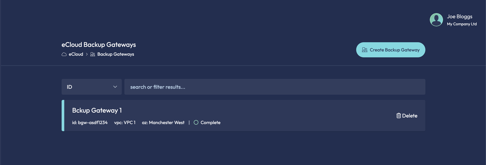
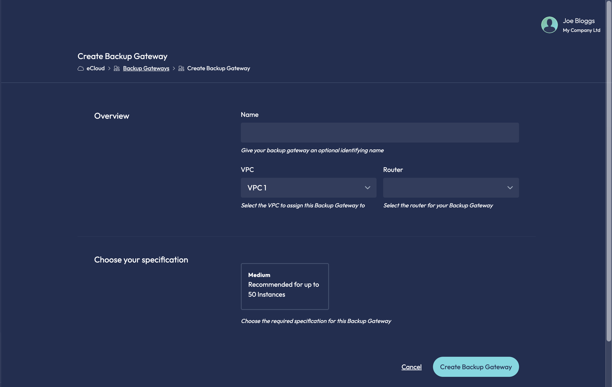
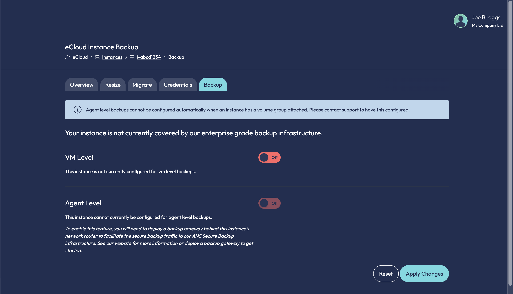
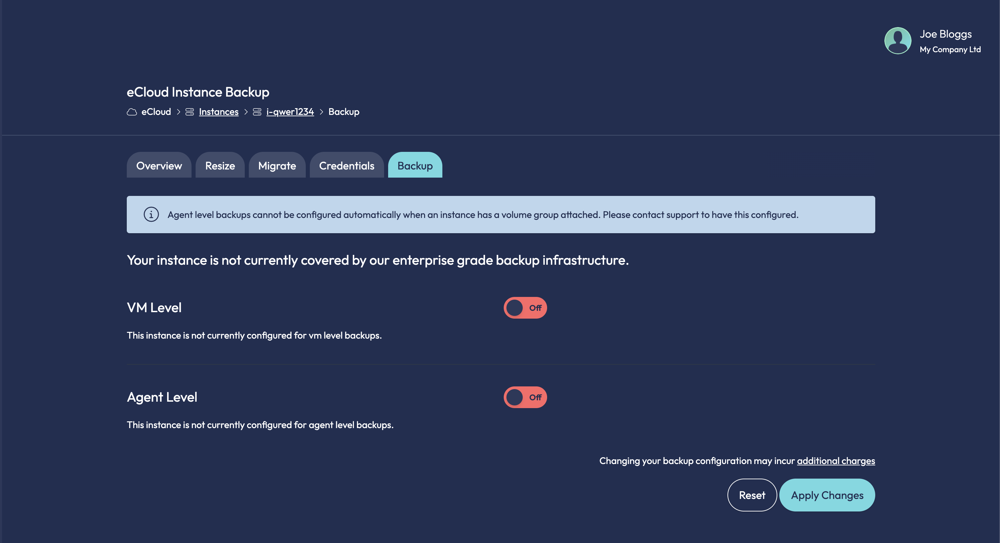
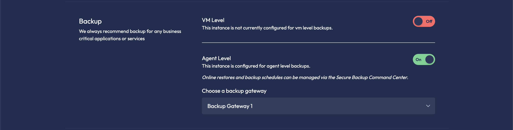
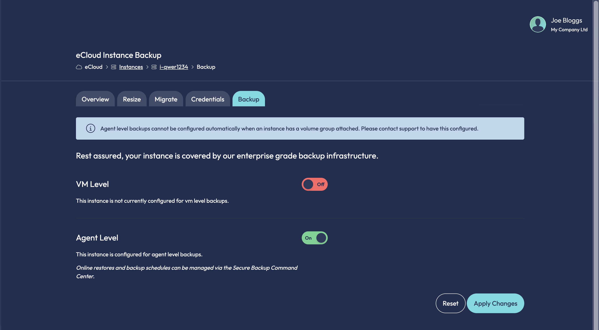

import Tabs from '@theme/Tabs';
import TabItem from '@theme/TabItem';

# Backup Gateways

A Backup Gateway lets the instances in your eCloud VPC send agent-level backups to ANS Secure Backup. This page explains what a Backup Gateway is, when to use one, and how to set one up from Glass, the API or the ANS CLI.

## What a Backup Gateway is

A Backup Gateway is a gateway that ANS deploys on your router. It carries backup traffic securely from the backup agent on your instances to ANS Secure Backup.

```text
VPC
└── Router
    ├── Backup Gateway ──────────► ANS Secure Backup
    └── Network
        ├── Instance (backup agent)
        ├── Instance (backup agent)
        └── Instance (backup agent)
```

A Backup Gateway is used for agent-level (file-level) backup. This is separate from VM-level backup, which snapshots the whole virtual machine and needs no gateway. An instance can use either kind of backup, or both.

## Why it exists and typical use cases

The gateway gives the backup agent inside each instance a private, managed route to Secure Backup. Typical use cases are:

- Restoring individual files, folders or application data, rather than the whole virtual machine.
- Protecting many instances behind one router with a single gateway.
- Combining agent-level backup with VM-level backup, so you can recover both whole machines and individual items.
- Keeping backup traffic on private networks. Your instances do not need a floating IP to be backed up.

## VM-level and agent-level backup

|  | VM-level backup | Agent-level backup |
| --- | --- | --- |
| Protects | The whole virtual machine | Files and applications inside the instance |
| Needs a Backup Gateway | No | Yes |
| Needs an agent in the instance | No | Yes |
| How it runs | A daily snapshot, each kept for 30 days | You pick from a predefined list of schedules |
| Restore | Whole virtual machine | Individual files and application data |
| Instance field | `backup_vm_enabled` | `backup_agent_enabled` |

For more on the two approaches, see [VM-level backups](/docs/backup-and-high-availability/general-backup-guidance/vm-level-backups/) and [file-level backups](/docs/backup-and-high-availability/general-backup-guidance/file-level-backups/).

## Before you start

You need:

- A Secure Backup organisation on your account. Without one, creating a Backup Gateway fails with a `412` error.
- A router in an availability zone that supports Secure Backup, and instances on a network behind that router.
- For the CLI examples, ANS CLI v1.33.0 or later.
- For the API examples, an API key with read/write access to eCloud.

The [Automating eCloud VPC with the ANS CLI](/docs/ecloud/vpc/automation/#before-you-start) guide explains how to install the CLI and supply your API key. The `curl` examples on this page use the same shorthand as that guide:

```bash
export ECLOUD="https://api.ukfast.io/ecloud/v2"
H=(-H "Authorization: ${ANS_API_KEY}" -H "Content-Type: application/json" -H "Accept: application/json")
```

All IDs in the examples (`vpc-abcdef12`, `rtr-abcdef12`, `bgw-abcdef12` and so on) are placeholders. Replace them with your own.

## Set up a Backup Gateway

The workflow has four steps: choose a specification, create the gateway, enable agent backup on the instance, then verify. Each step has tabs for Glass, the API and the CLI. The tab you pick is used for every step.

### 1. Choose a specification

The specification sets the size of the gateway. Each one has an `id`, a `name`, a `description` and an `order`. For example, "Medium, Recommended for up to 50 Instances". The specification must be offered in the availability zone of your router, otherwise creating the gateway fails with a `422` error.

<Tabs groupId="backup-gateway-method">
<TabItem value="glass" label="Glass" default>

You choose the specification on the create form in the next step, under **Choose your specification**.

</TabItem>
<TabItem value="api" label="API">

List the specifications offered in an availability zone (recommended):

```bash
curl -s "${H[@]}" "$ECLOUD/availability-zones/az-abcdef12/backup-gateway-specifications" | jq
```

Or list all specifications:

```bash
curl -s "${H[@]}" "$ECLOUD/backup-gateway-specs" | jq
```

</TabItem>
<TabItem value="cli" label="CLI">

```bash
ans ecloud backupgateway spec list
```

</TabItem>
</Tabs>

### 2. Create the gateway

Create the gateway on the router that your instances sit behind. The gateway takes its availability zone from the router. You can give it an optional name.

<Tabs groupId="backup-gateway-method">
<TabItem value="glass" label="Glass" default>

1. Go to **eCloud** > **Networking** > **Backup Gateways** and click **Create Backup Gateway**.
1. Enter a name (optional), then select the VPC and the router.
1. Under **Choose your specification**, select a specification.
1. Click **Create Backup Gateway**.





The gateway is ready when its status shows **Complete**.

</TabItem>
<TabItem value="api" label="API">

```bash
curl -s "${H[@]}" -X POST "$ECLOUD/backup-gateways" -d '{
  "name": "demo-backups",
  "vpc_id": "vpc-abcdef12",
  "router_id": "rtr-abcdef12",
  "gateway_spec_id": "bgws-abcdef12"
}' | jq
```

The API returns `202` with the ID of the gateway and the task that creates it. The gateway is ready when `sync.status` is `complete`:

```bash
curl -s "${H[@]}" "$ECLOUD/backup-gateways/bgw-abcdef12" | jq '.data.sync'
```

</TabItem>
<TabItem value="cli" label="CLI">

```bash
ans ecloud backupgateway create --vpc vpc-abcdef12 --router rtr-abcdef12 \
  --specification bgws-abcdef12 --name demo-backups --wait
```

`--wait` makes the command return once the gateway is ready. The [automation guide](/docs/ecloud/vpc/automation/#example-3-enable-backups) covers waiting and scripting in more detail.

</TabItem>
</Tabs>

### 3. Enable agent backup on an instance

The gateway must be ready, and in the same VPC, availability zone and router as the instance. Attaching the gateway (`backup_gateway_id`) and enabling the agent (`backup_agent_enabled`) are two settings. Enabling the agent needs a gateway, either sent in the same request or already set on the instance.

<Tabs groupId="backup-gateway-method">
<TabItem value="glass" label="Glass" default>

**For an existing instance:**

1. Open the instance and go to the **Backup** tab.
1. Turn on the **Agent Level** toggle.
1. Click **Apply Changes**.

Glass selects the gateway on the instance's router for you. If there is no gateway on the router, the toggle is disabled and the tab tells you to deploy one first.

The **Backup** tab always shows an information banner about volume groups. It only applies if the instance has a volume group attached. In that case, contact ANS support to have the agent configured.





**When launching an instance:**

In the **Backup** section of the launch form, turn on **Agent Level**, then select a gateway under **Choose a backup gateway**.



</TabItem>
<TabItem value="api" label="API">

Patch an existing instance:

```bash
curl -s "${H[@]}" -X PATCH "$ECLOUD/instances/i-abcdef12" \
  -d '{"backup_gateway_id": "bgw-abcdef12", "backup_agent_enabled": true}' | jq
```

To set it when creating an instance, send the same two fields in the `POST /instances` request body. If the instance already has the gateway set, send `{"backup_agent_enabled": true}` on its own.

</TabItem>
<TabItem value="cli" label="CLI">

```bash
ans ecloud instance update i-abcdef12 --backup-gateway-id bgw-abcdef12 --wait
```

This also enables the agent. You can also pass `--backup-gateway-id` to `ans ecloud instance create`. If the instance already has a gateway but the agent is not enabled, use `--enable-agent-backups`:

```bash
ans ecloud instance update i-abcdef12 --enable-agent-backups --wait
```

</TabItem>
</Tabs>

### 4. Verify

The agent is installed by a separate task named `instance_enable_backup`, which runs after the instance has finished its own deployment or update. Once the agent is installed and registered, `secure_backup` on the instance becomes `true`.

<Tabs groupId="backup-gateway-method">
<TabItem value="glass" label="Glass" default>

The **Backup** tab shows "This instance is configured for agent level backups". Restores and backup schedules are managed in the Secure Backup Command Center.



</TabItem>
<TabItem value="api" label="API">

Check the `instance_enable_backup` task:

```bash
curl -s "${H[@]}" "$ECLOUD/instances/i-abcdef12/tasks?name:eq=instance_enable_backup" | jq '.data[] | {id, name, status}'
```

Then check the instance:

```bash
curl -s "${H[@]}" "$ECLOUD/instances/i-abcdef12" | jq '.data | {backup_vm_enabled, backup_agent_enabled, backup_gateway_id, secure_backup}'
```

</TabItem>
<TabItem value="cli" label="CLI">

Check the `instance_enable_backup` task:

```bash
ans ecloud instance task list i-abcdef12 --filter name=instance_enable_backup
```

Then check the instance. `--with-backup` shows the backup fields, and shows `secure_backup` as `backup_agent_installed`:

```bash
ans ecloud instance show i-abcdef12 --with-backup
```

</TabItem>
</Tabs>

## Instance backup fields

| Field | Meaning |
| --- | --- |
| `backup_enabled` | Legacy field. Use `backup_vm_enabled` instead. |
| `backup_vm_enabled` | VM-level backup is enabled. |
| `backup_agent_enabled` | Agent-level backup is enabled. Requires a `backup_gateway_id`. |
| `backup_gateway_id` | The Backup Gateway the instance uses. It cannot be changed once set. |
| `secure_backup` | `true` once the agent is installed and registered. Shown as `backup_agent_installed` in the CLI. |

## Limits and troubleshooting

| Symptom | Cause and fix |
| --- | --- |
| `412` when creating a gateway: "Backup Gateway requires customers organisation to be registered with Commvault." | Your account has no Secure Backup organisation. Contact ANS support to have one set up. |
| `412` when deleting a gateway | Instances are still attached to it. Gateways cannot be deleted while in use. |
| `422` when creating a gateway | The specification is not offered in the router's availability zone. Choose one from that zone's specification list. |
| `422` when assigning a gateway to an instance | The gateway must be in the same VPC, availability zone and router as the instance. |
| "Agent level backups cannot be enabled without setting the backup gateway id" | Send `backup_gateway_id` with `backup_agent_enabled`, or set the gateway first. |
| "Instance already has a backup gateway" | An instance's gateway cannot be changed once set. |
| "Agent level backups cannot be disabled" | You cannot disable the agent once `secure_backup` is `true`. Contact ANS support. |
| The `instance_enable_backup` task fails | The gateway may not be ready. Wait until its `sync.status` is `complete` and try again. |
| The instance has a volume group attached | The agent cannot be configured automatically on these instances. Contact ANS support to have the agent configured. |

## Managing and deleting gateways

You can only update the name of a gateway. To delete a gateway, first disable agent backup on every instance that uses it. If the agent is already installed on an instance (`secure_backup` is `true`), you cannot disable it yourself. Contact ANS support, or delete the instance. Then delete the gateway from the **Backup Gateways** list in Glass, or with the API or CLI:

```bash
ans ecloud backupgateway delete bgw-abcdef12
```

```bash
curl -s "${H[@]}" -X DELETE "$ECLOUD/backup-gateways/bgw-abcdef12" | jq
```

A router cannot be deleted while it still has a Backup Gateway.

## Related links

- [Automating eCloud VPC with the ANS CLI: enable backups](/docs/ecloud/vpc/automation/#example-3-enable-backups)
- [eCloud API reference](https://developers.ukfast.io/documentation/ecloud)
- [General backup guidance](/docs/backup-and-high-availability/general-backup-guidance/)
- [eCloud VPC Instances](/docs/ecloud/vpc/instances/)
